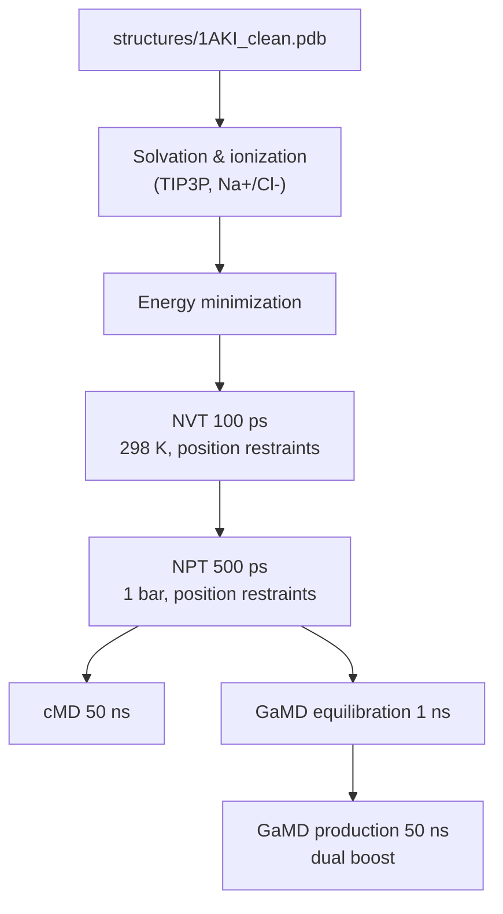

<div align="center">

# cMD & GaMD of Lysozyme in GROMACS


A reproducible GROMACS workflow that prepares hen egg-white lysozyme (PDB [1AKI](https://www.rcsb.org/structure/1AKI)), equilibrates it, then runs **50 ns of conventional MD (cMD)** and **50 ns of Gaussian accelerated MD (GaMD)** from an identical starting state.

[Overview](#overview) • [Requirements](#requirements) • [Configuration](#configuration) • [Running](#running) • [Simulation setup](#simulation-setup) • [Outputs](#outputs)

</div>

## Overview

The pipeline takes a cleaned lysozyme structure through the standard GROMACS preparation steps (solvation, ionization, minimization, NVT/NPT equilibration), then branches into two production runs that share the same equilibrated coordinates:

- **cMD** — a 50 ns unbiased simulation, serving as the reference.
- **GaMD** — a 1 ns GaMD equilibration (boost parameter collection) followed by a 50 ns production run with dual boost applied. GaMD does not speed up the dynamics itself; it smooths the potential energy surface so that rare conformational states are sampled more often within the same amount of simulation time.



## Features

- **Fair comparison**: both cMD and GaMD start from the exact same minimized, equilibrated structure.
- **Dual-boost GaMD**: `igamd 3` applies boost to the total potential and to dihedral energies, with a target threshold of `σ₀ = 6.0 kcal/mol` for both boost potentials.
- **GPU-offloaded production**: `mdrun` runs with `-nb gpu -pme gpu -bonded gpu -update gpu` (1 MPI rank × 8 OpenMP threads by default).
- **Single-command pipeline**: one `run.sh` drives every stage, aborting on the first failure (`set -e`).
- **Reweighting-ready**: GaMD runs write boost-potential output and restart files needed to recover the canonical distribution and to continue boosted simulations.

## Requirements

- [GROMACS](https://www.gromacs.org/) 2021 or newer, built with GPU support (`C-rescale` barostat and `-update gpu` are used).
- An NVIDIA GPU for the production stages — the script passes GPU-offload flags to `mdrun`.
- A **GaMD-patched GROMACS build** for the accelerated stages. Stock GROMACS rejects the `gamd = yes` option and does not read the `gamd.in` boost-parameter files.
- Bash on Linux.

> [!NOTE]
> You can still run the preparation and cMD stages with a standard GROMACS build — only the `gamd_1` and `gamd_prod` stages require the patched binary.

## Configuration

Edit the variables at the top of [`run.sh`](run.sh) before running:

```bash
PDB="structures/1AKI_clean.pdb"   # input structure
INPUT="inputs"                    # mdp / gamd.in directory
GROMACS="pathtogromacs"           # path to your gmx binary (or mdrun wrapper)

# Threading for the GaMD stages
NTMPI=1
NTOMP=8
PIN=on
```

> [!IMPORTANT]
> `GROMACS` is a placeholder — replace it with the path to your `gmx` executable (e.g. `/opt/gromacs/bin/gmx`) or the pipeline will fail immediately.

> [!TIP]
> `pdb2gmx` is called without `-ff`, so it prompts for a force field interactively. The `.mdp` files were written for **OPLS/AA**, so select it when prompted, or add `-ff oplsaa -water tip3p` to the `pdb2gmx` call in `run.sh` to make the run fully non-interactive.

## Running

From the repository root:

```bash
chmod +x run.sh   # first time only
./run.sh
```

The script prints a timestamp around each `mdrun` call so wall-clock timings are visible in the terminal output, and finishes with `ALL DONE`.

> [!WARNING]
> The script aborts on the first error (`set -e`) and uses a plain `mkdir` for `cMD/`, so re-running it in a directory that already contains output stops immediately. Start from a clean checkout, or remove the generated output directories before a re-run.

## Simulation setup

All dynamics run in a **cubic box with 1.2 nm clearance**, periodic boundary conditions, and the **TIP3P** water model. The `.mdp` files under [`inputs/`](inputs/) share the following settings:

| Setting | Value |
| --- | --- |
| Timestep | 2 fs (bonds to H constrained, LINCS) |
| Electrostatics | PME, 1.2 nm cutoff, 4th-order interpolation |
| van der Waals | force-switch 1.0–1.2 nm, no dispersion correction |
| Thermostat | V-rescale, 298 K, τ = 1.0 ps |
| Barostat | C-rescale, isotropic, 1 bar, τ = 5.0 ps |
| Coordinate saving | every 10 ps (whole system) |

Stages executed by `run.sh`:

| Stage | Parameter file | Length | Notes |
| --- | --- | --- | --- |
| Ion placement | `ions.mdp` | — | neutralize with Na⁺/Cl⁻ |
| Minimization | `minim.mdp` | ≤ 50 000 steps | steepest descent, Fₘₐₓ < 1000 kJ/mol/nm |
| NVT | `nvt.mdp` | 100 ps | velocities assigned at 298 K, protein restrained |
| NPT | `npt.mdp` | 500 ps | pressure coupling, protein restrained |
| cMD | `cMD_50ns.mdp` | 50 ns | unbiased reference run |
| GaMD equilibration | `gamd_equil.mdp` + `gamd.in` | 1 ns | collects boost parameters (`irest_gamd 0`) |
| GaMD production | `gamd_50ns.mdp` + `gamd_prod.in` | 50 ns | continues from GaMD restart files (`irest_gamd 1`) |

### GaMD parameters

Boost behaviour is controlled by [`inputs/gamd.in`](inputs/gamd.in) and [`inputs/gamd_prod.in`](inputs/gamd_prod.in):

| Parameter | Equilibration | Production | Meaning |
| --- | --- | --- | --- |
| `igamd` | 3 | 3 | dual boost: total potential + dihedrals |
| `iE` / `iEP` / `iED` | 1 | 1 | write energy terms needed for reweighting |
| `ntcmdprep` / `ntcmd` | 50000 / 150000 | — | canonical MD sampling before boost is applied |
| `ntebprep` / `nteb` | 50000 / 200000 | — | boost energy spreading (equilibration) stage |
| `ntave` | 50000 | — | averaging window for boost parameters |
| `sigma0P` / `sigma0D` | 6.0 | 6.0 | lower bound on the std. dev. of boost potentials (kcal/mol) |
| `reweight_nst` / `para_nst` | 50 | 50 | output frequency for reweighting / parameter updates |
| `irest_gamd` | 0 | 1 | start fresh / continue from `gamd-restart.dat` |

The restart files (`gamd-restart.dat`, `gamd-restart-prev.dat`) generated during equilibration are copied into the production directory by the script, so the boost parameters carry over seamlessly.

## Outputs

Each production stage writes into its own directory to keep cMD and GaMD artifacts separate:

```
cMD/        md_50ns.{xtc,cpt,edr,log,gro}   # conventional MD
gamd_1/     gamd.{xtc,cpt,edr,log,gro}      # GaMD equilibration
            gamd-restart*.dat               # boost parameters for continuation
gamd_prod/  gamd_prod.{xtc,cpt,edr,log,gro} # GaMD production
            gamd_prod.energy*               # boost potentials for reweighting
```

The compressed `.xtc` trajectories contain the whole system at 10 ps intervals. For quantitative comparison of free-energy landscapes, reweight the GaMD trajectories using the boost-potential output (e.g. with the [PyReweighting](https://github.com/MiaoLab20/pyreweighting) toolkit).

## References

- [1AKI — Hen egg-white lysozyme, orthorhombic form, 1.5 Å](https://www.rcsb.org/structure/1AKI)
- Dual-boost GaMD method: Pang, Y.; Miao, Y.; Wang, Y.; McCammon, J. A. [_Gaussian Accelerated Molecular Dynamics in NAMD_](https://doi.org/10.1021/acs.jctc.6b00931). J. Chem. Theory Comput. **2017**, 13, 9–19.
- [GROMACS documentation](https://manual.gromacs.org/)
